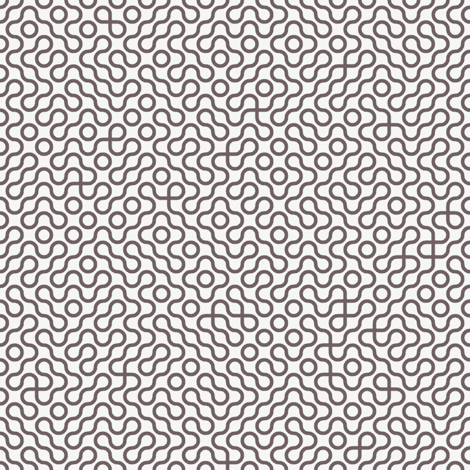
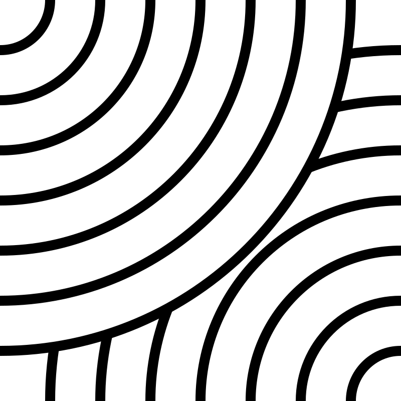
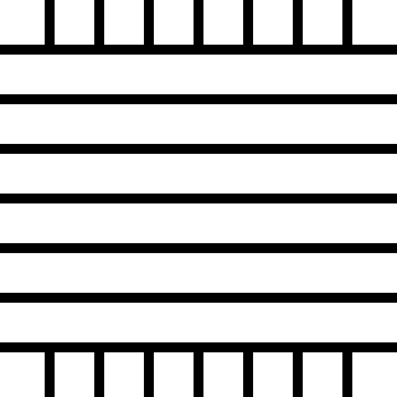
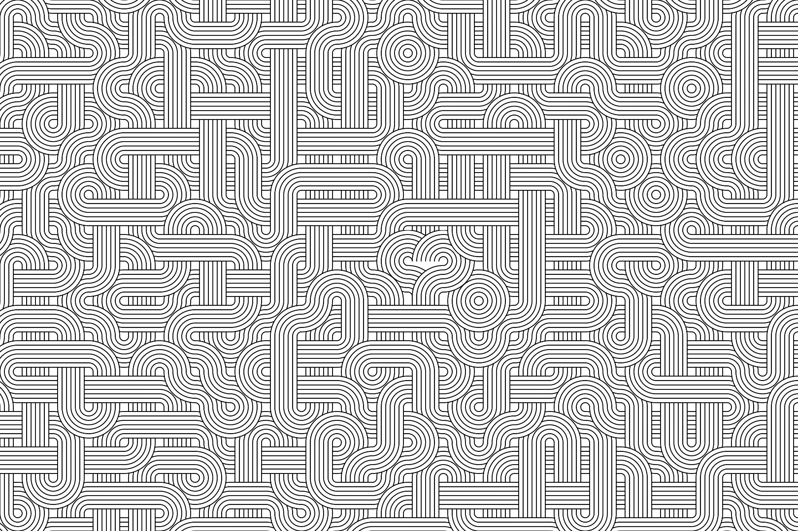

Noodle Love is a generative art piece that creates large-format compositions through algorithmic tile placement and rotation.


 

When researching [Truchet tiles](https://en.wikipedia.org/wiki/Truchet_tiles), I explored ways to put the focus on the visual aspects and less on the algorithms. I wanted to create a pieces that was more about the aesthetics of the patterns than the underlying code.

A first iteration focused on the algorithm, not on the eastetics, tiles were drawn in code and I wanted to draw them in a drawing program.



 


This led me to tiles drawn by "hand", either in a vector drawing program, or by hand and then scanned. Rather than tiles drawn with code.

Additionally, the code places a special tile in the center. This tile also connects to all other tiles, but is larger. It shows a heart shape.
This makes the image look like a maze in which we can find the love, if we look carefully.




By improving the output, I can generate extremely large patterns that can themselves be tiled. Allowing me to order wrapping paper from it.



## How does it work?

1. All textures connect to other textures regardless of their rotation.
1. The algorithm divides the canvas into tiles.
1. Each tile receives one of the hand-drawn textures and a rotation (0°, 90°, 180°, or 270°).
1. Rather than random placement, the system uses Perlin noise to determine both texture selection and rotation, creating smooth transitions and organic flow across the composition.
1. Find a center corner and place the center tile there, over any tiles that may sit there.

```java
void draw() {
  tiles.clear();
  float tiles_x = width / TILE_SIZE + 1;
  float tiles_y = height / TILE_SIZE + 1;
  // Fill the grid with random tiles and give them random rotation
  for (int x = 0; x < tiles_x; x++) {
    for (int y = 0; y < tiles_y; y++) {
      PVector pos = new PVector(x * TILE_SIZE, y * TILE_SIZE);
      float rotation = generateRotation(x, y);
      int texture_idx = generateTextureIdx(x, y);
      Tile t = new Tile(pos, rotation, texture_idx);
      tiles.add(t);
    }
  }

  // Draw the tiles
  background(0);
  for (Tile t : tiles) {
    t.draw();
  }

  // Find a center corner of the grid of tiles
  PVector actual_center = new PVector(width/2, height/2);
  PVector center_tile_corner = null;
  for (Tile t : tiles) {
    if (t.pos.dist(actual_center) < TILE_SIZE) {
      center_tile_corner = t.pos;
      break;
    }
  }
  if (center_tile_corner == null) {
    throw new Error("Could not place a center tile");
  }
}
```

## Tools

* Processing for the rendering engine
* Perlin noise algorithm for texture and rotation distribution
* Custom hand-drawn tile textures in SVG
* Designed for large-format output (200.6cm × 70.6cm at 300 DPI)

## Sourcecode and history

- [Processing version](https://github.com/berkes/art/tree/main/processing/NoodleLove)


